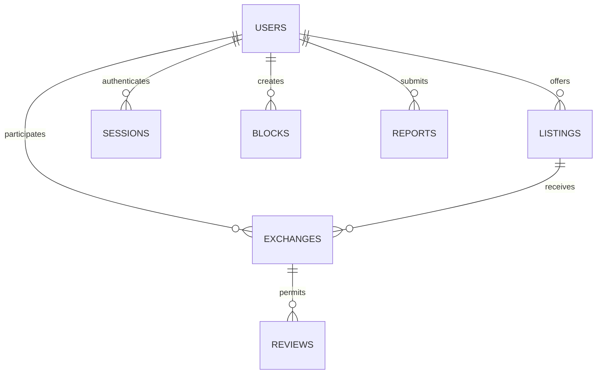
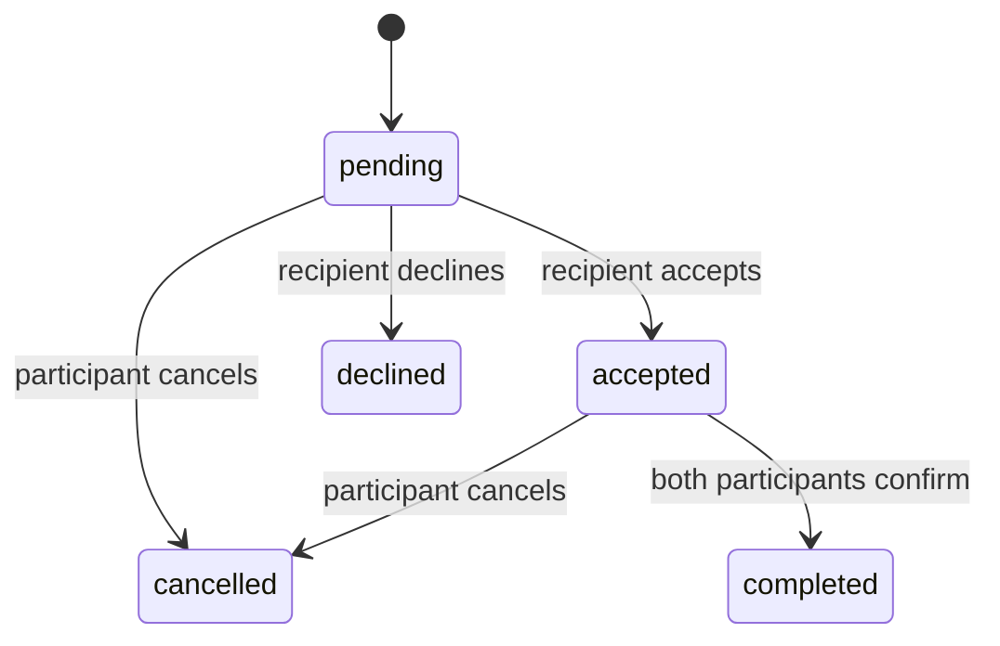

# Architecture

The browser renders React and calls a same-origin API. Vinext bundles route handlers into a Cloudflare Worker. D1 stores durable live data. The demo is a separate browser-local dataset and never writes to the live database.

## Data model

An exchange has both `from_id` (requester) and `to_id` (listing owner). The offered skill is a snapshot string so the agreement remains understandable if a later version supports listing edits. Review IDs combine exchange and author IDs to enforce one review per participant. Block IDs combine blocker and target IDs.

## State transitions

A completion flag records each participant’s confirmation. A conditional update checks the previous state and both flags to avoid overwriting concurrent updates. No action can reopen a closed exchange. The API rechecks ownership for every action; hiding a UI button is not authorization.

## API

| Method | Route | Purpose |
| --- | --- | --- |
| GET | `/api/me` | Current public profile, or null |
| POST | `/api/auth/signup` | Create account and session |
| POST | `/api/auth/login` | Authenticate |
| POST | `/api/auth/logout` | Revoke current session |
| POST | `/api/profile` | Update own profile |
| GET | `/api/listings` | Browse offers; omit blocked members |
| POST | `/api/listings` | Publish own skill |
| GET | `/api/exchanges` | Own sent and received proposals |
| POST | `/api/exchanges` | Propose a dated swap |
| POST | `/api/exchanges/:id` | Accept, decline, cancel, complete |
| POST | `/api/reviews` | Review a completed participant exchange |
| POST | `/api/block` | Hide and prevent new swaps with a member |
| POST | `/api/report` | Store report for manual review |

Mutating requests require a valid session except account registration/login. Cross-origin browser requests are refused. Sessions use HttpOnly, SameSite=Lax cookies; HTTPS also sets Secure. Requests use parameterized SQL and bounded input lengths. The local integration suite exercises the real route code with an ephemeral database.

## Matching

The score is deliberately explainable: two points when an offered title overlaps with a comma-separated learning interest, and one point when the listing’s desired skills overlap with one of your offered titles. It uses case-insensitive substring matching, not AI or a semantic search model. Exact vocabulary and synonyms can therefore affect results. A mutual-match badge requires all three points.

## Development notes

- Schema changes: edit `db/schema.ts`, run `npm run db:generate`, inspect generated SQL, build, then run `npm run db:local`.
- Do not modify migrations after applying them; add a new migration.
- Local and hosted databases are independent. Production deploys apply the tracked migrations.
- Run `npm run test:api` for isolated route/database tests.
- In-person session locations and external meeting links are plain text in proposal notes; there is no embedded meeting service.
- Saved skills are browser-local and shared across demo personas on that device. Live saved IDs have no effect on the demo dataset.
